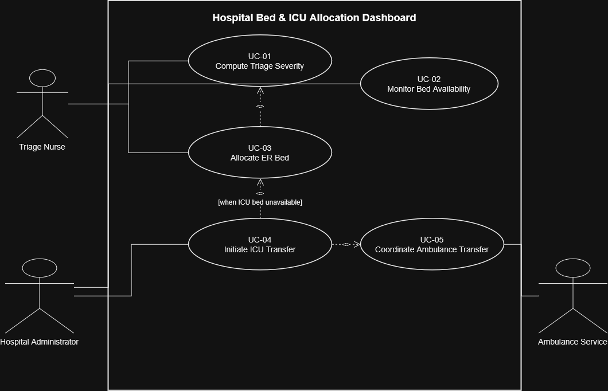
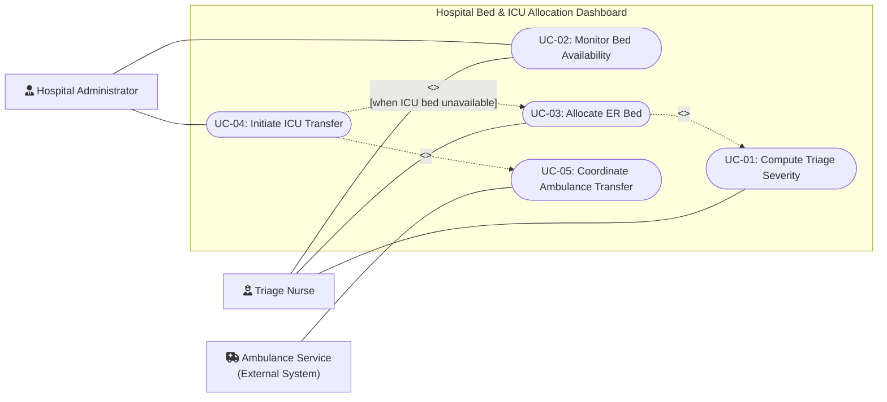

# Hospital Bed & ICU Allocation Dashboard

**Problem Statement #20 | Healthcare & Telemedicine**  
**Course:** Software Engineering Lab 1 (Requirements Engineering & UML Use-Case Modelling)  
**Department of Computer Science & Engineering, PES University**  
**Student:** Shriya K  
**SRN:** PES1UG24CS448  

---

## Table of Contents
1. [Project Overview](#1-project-overview)
2. [Problem Statement & Scope](#2-problem-statement--scope)
3. [Repository Structure](#3-repository-structure)
4. [Functional Requirements (FR)](#4-functional-requirements-fr)
5. [Non-Functional Requirements (NFR)](#5-non-functional-requirements-nfr)
6. [UML Use-Case Modelling](#6-uml-use-case-modelling)
   - [Use-Case Diagram](#use-case-diagram)
   - [Actors Specification](#actors-specification)
   - [Relationships (Include & Extend)](#use-case-relationships)
7. [Use-Case Flow Specification (UC-04: ICU Transfer)](#7-use-case-flow-specification-uc-04)
8. [System Architecture & Selection Justification](#8-system-architecture--selection-justification)
   - [Layered Architecture Diagram](#layered-architecture-diagram)
   - [Layer Breakdown](#layer-breakdown)
   - [Architectural Justification](#architectural-justification)
9. [Requirements Traceability Matrix](#9-requirements-traceability-matrix)

---

## 1. Project Overview

The **Hospital Bed & ICU Allocation Dashboard** is a mission-critical emergency department clinical management system designed to:
- Compute objective patient triage acuity scores from clinical intake vitals.
- Dynamically prioritize the emergency room (ER) bed allocation waiting list based on medical urgency rather than arrival time.
- Provide continuous, real-time tracking of bed availability across emergency rooms, general wards, and intensive care units (ICUs) with sub-second status synchronization via WebSockets.
- Orchestrate end-to-end inter-facility ICU patient transfer workflows and emergency ambulance dispatches when internal ICU capacity is exhausted.

---

## 2. Problem Statement & Scope

### Context
Emergency departments frequently face bed shortages and surge pressures where immediate access to critical care is a matter of life and death. Traditional First-Come, First-Served (FIFO) admission models introduce dangerous delays for high-acuity patients. 

### Key Capabilities
1. **Intake Triage Calculation:** Ingest vitals and compute standardized acuity scores.
2. **Dynamic ER Prioritization:** Continuously re-rank the waiting list to ensure the most critical patients receive care first.
3. **Multi-Ward Bed Monitoring:** Live display of bed status (`Available`, `Occupied`, `Cleaning`) across ER, Ward, and ICU units.
4. **Automated Bed Allocation:** Match available beds to waiting patients based on acuity and clinical resource needs.
5. **ICU Capacity Escalation:** Detect local ICU saturation and initiate external transfer requests to partner facilities.
6. **Ambulance Dispatch Coordination:** Electronically request, track, and confirm emergency transport with external ambulance services.

---

## 3. Repository Structure

```text
SE_LAB1_ACTIVITY_SHRIYA_K_PES1UG24CS448/
├── README.md                                          # Master documentation & project summary
├── 20_SE_Lab1_SE_Problem_Statements.pdf               # Lab problem statement & submission guidelines
├── Architecture_Selection_Justification.docx          # Academic architecture justification writeup
├── Monochrome UML Hospital Architecture Diagram(1).png # UML Component & Layered Architecture Diagram
│
├── requirements/
│   ├── Requirements_Table.md                          # Complete 5 FRs and 2 NFRs specification table
│   ├── Alternate_Flow.md                              # Detailed alternate flows for all functional requirements
│   └── Exception_Flow.md                              # Exception scenarios, edge cases, and recovery flows
│
├── uml/
│   ├── Use_Case_Diagram.md                            # Comprehensive Use Case specifications & Mermaid diagram
│   └── Use_Case_Diagram.png                           # Exported UML Use-Case Diagram
│
└── use-case-flow/
    └── ICU_Transfer_Flow.md                           # Formal 1-page IEEE Use-Case Flow Specification (UC-04)
```

---

## 4. Functional Requirements (FR)

The system defines exactly five core functional requirements adhering to Lab 1 submission criteria:

| Req ID | Type | Description | Priority | Acceptance Criteria | Rationale |
|:---:|:---:|---|:---:|---|---|
| **FR-001** | Functional | The system shall compute triage severity scores from intake vitals (BP, HR, SpO2, Temp, RR, Consciousness) and dynamically order the ER bed allocation waitlist. | High | **Pass:** Higher acuity patient automatically moves ahead of lower acuity patient.<br/>**Fail:** FIFO queue ignores critical emergency. | Ensures critical patients receive immediate care based on physiological urgency. |
| **FR-002** | Functional | The system shall display the real-time status of ER, ward, and ICU beds as Available, Occupied, or Cleaning across connected client dashboards. | High | **Pass:** Bed status changes reflect on dashboards within 1 second.<br/>**Fail:** Dashboard displays stale status after 1 second. | Provides live situational awareness for bed allocation and transfer decisions. |
| **FR-003** | Functional | The system shall allocate an available ER bed to a patient according to triage priority and bed compatibility. | High | **Pass:** Available bed is assigned to highest-priority eligible patient and updates to Occupied.<br/>**Fail:** Lower-priority patient assigned while higher-priority patient waits. | Prevents misallocation and reduces boarding delays for high-acuity patients. |
| **FR-004** | Functional | The system shall identify patients requiring ICU transfer and generate an inter-facility transfer request when no suitable internal ICU bed is available. | High | **Pass:** System generates transfer request with patient and partner hospital details when local ICU is full.<br/>**Fail:** No transfer request generated despite zero local beds. | Enables rapid escalation to regional partners when internal intensive care is saturated. |
| **FR-005** | Functional | The system shall send ambulance transfer requests to external ambulance services and record resulting transfer status (Requested, Confirmed, Rejected). | Medium | **Pass:** Transfer request sent to ambulance API and resulting status recorded.<br/>**Fail:** Request sent without tracking response status. | Ensures accountability, tracking, and seamless handoff for patient transit. |

---

## 5. Non-Functional Requirements (NFR)

| Req ID | Type | Description | Priority | Acceptance Criteria | Rationale |
|:---:|:---:|---|:---:|---|---|
| **NFR-001** | Non-Functional (Performance & Real-Time) | Bed status transitions (Occupied, Cleaning, Available) must propagate to all connected ER dashboard clients in under 1 second via WebSockets. | High | **Pass:** Benchmarking tests confirm $\ge 95\%$ of updates arrive in $< 1.0$ s under simulated peak concurrency.<br/>**Fail:** $> 5\%$ of updates exceed 1 second. | Real-time visibility is vital to prevent bed allocation bottlenecks during critical emergencies. |
| **NFR-002** | Non-Functional (Security & Access Control) | The system shall restrict patient and bed-management functions to authenticated and authorized users based on role-based access control (RBAC). | High | **Pass:** Nurses access triage/allocation; Administrators access transfer management; unauthorized actions return HTTP 403.<br/>**Fail:** Any user accesses operations beyond their assigned privileges. | Protects sensitive Protected Health Information (PHI) and hospital infrastructure controls. |

---

## 6. UML Use-Case Modelling

### Use-Case Diagram





### Actors Specification

1. **Triage Nurse (Primary Actor):** Enters intake vitals, triggers triage calculation, monitors real-time bed states, and allocates ER beds to waiting patients.
2. **Hospital Administrator (Primary Actor):** Monitors hospital-wide ward occupancy, reviews regional capacity, and authorizes inter-facility ICU transfer requests.
3. **Ambulance Service (Secondary / External System Actor):** Receives transfer dispatches, acknowledges availability, confirms bookings with vehicle ETA, and transmits transit updates.

### Use-Case Relationships

#### 1. `<<include>>` Relationships
- **`UC-03 (Allocate ER Bed) -- <<include>> --> UC-01 (Compute Triage Severity)`**:  
  Bed allocation strictly depends on computing and retrieving the dynamic triage score to select the highest-urgency patient.
- **`UC-04 (Initiate ICU Transfer) -- <<include>> --> UC-05 (Coordinate Ambulance Transfer)`**:  
  Executing an inter-facility ICU transfer unconditionally requires dispatching patient transit via the Ambulance Service.

#### 2. `<<extend>>` Relationships
- **`UC-04 (Initiate ICU Transfer) -- <<extend>> --> UC-03 (Allocate ER Bed)`**:  
  - **Extension Point:** `ER Bed Allocation / Capacity Assessment`  
  - **Condition:** `[when ICU bed unavailable]`  
  - **Description:** When an emergency patient requires ICU level of care during allocation, but all internal ICU beds are occupied or cleaning, the workflow extends to initiate an external inter-facility ICU transfer.

*Detailed use case specifications are available in [uml/Use_Case_Diagram.md](uml/Use_Case_Diagram.md).*

---

## 7. Use-Case Flow Specification (UC-04)

The core use case **UC-04: Initiate ICU Inter-Facility Transfer** is fully documented as a formal 1-page IEEE specification in [use-case-flow/ICU_Transfer_Flow.md](use-case-flow/ICU_Transfer_Flow.md).

### Summary of UC-04 Flow
- **Preconditions:** Authenticated Hospital Administrator; Patient evaluated with high-acuity score requiring ICU care; Internal ICU bed availability confirmed at zero.
- **Main Success Scenario:**
  1. System detects zero available internal ICU beds for a critical patient.
  2. Administrator accesses Transfer Management module.
  3. System queries regional partner hospitals and displays ranked list of facilities with available ICU beds.
  4. Administrator selects destination facility and initiates transfer.
  5. System generates transfer record (`Requested`) and dispatches transport request to Ambulance Service (**UC-05**).
  6. Ambulance Service accepts request with Unit ID and ETA (`Confirmed`).
  7. Real-Time Event Service pushes update via WebSockets to all connected clients within 1 second (**NFR-001**).
- **Alternate Flows:**
  - *Internal ICU Bed Becomes Available Prior to Dispatch:* Bed cleaning completes locally; external transfer is cancelled and patient is assigned internally.
  - *Multiple Partner Facilities Available:* System ranks facilities by transit time and specialty capability match.
- **Exception Flows:**
  - *Zero Partner ICU Beds Available:* System escalates to pending emergency mutual-aid status and maintains patient in ER holding bay.
  - *Ambulance Service Rejection/Timeout:* System automatically fails over to contracted secondary transport provider.

---

## 8. System Architecture & Selection Justification

### Layered Architecture Diagram

.png)

```text
                    ┌──────────────────────────────────────────────┐
                    │               ACTORS / SYSTEMS               │
                    │                                              │
                    │   Triage Nurse         Hospital Admin        │
                    │         \                    /               │
                    └──────────┼──────────────────┼────────────────┘
                               │ (HTTPS)          │ (HTTPS)
                               ▼                  ▼
┌──────────────────────────────────────────────────────────────────────────────────┐
│ 1. PRESENTATION LAYER (Web Dashboard UI)                                         │
│    Patient Intake UI │ ER Waitlist UI │ Bed Status UI │ Transfer Management UI   │
└──────────────────────────────────────┬───────────────────────────────────────────┘
                                       │ REST / JSON (API Gateway)
                                       ▼
┌──────────────────────────────────────────────────────────────────────────────────┐
│ 2. AUTHENTICATION & AUTHORIZATION LAYER (RBAC)                                   │
│    JWT Authentication │ Role-Based Access Control │ Session Management           │
└──────────────────────────────────────┬───────────────────────────────────────────┘
                                       │ Authorized Service Calls
                                       ▼
┌──────────────────────────────────────────────────────────────────────────────────┐
│ 3. BUSINESS LOGIC LAYER (Application Services)                                   │
│    ┌──────────────────┐  ┌──────────────────┐  ┌───────────────────────────────┐ │
│    │  Triage Service  │  │  Bed Allocation  │  │    Bed Management Service     │ │
│    └──────────────────┘  └──────────────────┘  └───────────────────────────────┘ │
│    ┌────────────────────────────────────────┐  ┌───────────────────────────────┐ │
│    │          ICU Transfer Service          │  │   Ambulance Transfer Service  │ │
│    └───────────────────┬────────────────────┘  └───────────────┬───────────────┘ │
└────────────────────────┼───────────────────────────────────────┼─────────────────┘
                         │ Status Events                         │ Dispatch API
                         ▼                                       ▼
┌─────────────────────────────────────────────┐     ┌──────────────────────────────┐
│ 4. REAL-TIME EVENT LAYER (WebSocket Server) │     │ 5. EXTERNAL AMBULANCE SYSTEM │
│    Sub-second push updates (< 1s)           │     │    Dispatch API & Telemetry  │
│    Bed transitions, waitlists, transfers    │     └──────────────────────────────┘
└────────────────────────┬────────────────────┘
                         │ Persistence (CRUD)
                         ▼
┌──────────────────────────────────────────────────────────────────────────────────┐
│ 6. DATA LAYER (Storage & Database)                                               │
│    Patient Database    │ Bed Inventory Database  │ Transfer & Audit Database     │
└──────────────────────────────────────────────────────────────────────────────────┘
```

### Layer Breakdown
1. **Presentation Layer (Web Application):** Modular web interface with specialized dashboards for Triage Intake, ER Waitlist, Real-Time Bed Board, and Transfer Management.
2. **Security & Gateway Layer:** Unified API entry point providing JSON Web Token (JWT) verification and granular Role-Based Access Control (**NFR-002**).
3. **Business Logic Layer:** Encapsulates core medical rules, including triage score algorithms, ER priority queues, bed allocation policies, and transfer workflows.
4. **Real-Time Event Layer:** High-throughput WebSocket server broadcasting instantaneous bed transitions, waitlist adjustments, and transfer confirmations to active clients in $< 1$ second (**NFR-001**).
5. **External Integration Layer:** Secure REST client interfacing with regional partner hospitals and ambulance dispatch providers.
6. **Data Layer:** ACID-compliant relational databases maintaining patient records, bed states, audit logs, and transfer documentation.

### Architectural Justification

1. **Separation of Concerns:**  
   Decoupling the presentation, business logic, event broadcasting, and data persistence layers ensures that critical modules—such as triage computation, bed allocation, and inter-facility transfer orchestration—can be developed, tested, maintained, and scaled independently without risking core clinical workflows.

2. **Dedicated Real-Time Event Architecture for Emergency Operations:**  
   In emergency care, polling-based architectures introduce dangerous data staleness and unnecessary server load. Incorporating a dedicated WebSocket event layer enables push-based state synchronization, guaranteeing that bed transitions propagate to all ER screens in under 1 second (**NFR-001**).

3. **Robust Security & Regulatory Compliance (RBAC):**  
   Placing a dedicated API Gateway and Authentication/Authorization service between the client dashboard and backend services provides a strict, centralized security perimeter. This ensures clinical actions (such as authorizing transfers or modifying patient records) are strictly enforced by role permissions (**NFR-002**).

4. **Fault Tolerance and Service Decoupling:**  
   External ambulance and partner hospital communications are isolated behind asynchronous integration adapters. A temporary slowdown or failure in external third-party services never degrades internal triage calculation or ER bed allocation operations.

---

## 9. Requirements Traceability Matrix

| Requirement ID | Requirement Type | Priority | Primary Actor | Mapped Use Case | Architectural Component | Verification Method |
|:---:|:---:|:---:|:---:|:---:|:---:|:---:|
| **FR-001** | Functional | High | Triage Nurse | UC-01 | Triage Service, Patient DB | Automated test: Acuity-based priority queue ordering |
| **FR-002** | Functional | High | Nurse / Admin | UC-02 | Bed Management Service, WebSocket | Integration test: Bed status broadcast validation |
| **FR-003** | Functional | High | Triage Nurse | UC-03 | Bed Allocation Service, Bed DB | End-to-end test: Highest-urgency bed assignment |
| **FR-004** | Functional | High | Hospital Admin | UC-04 | ICU Transfer Service, Transfer DB | Scenario test: Transfer request generation on zero beds |
| **FR-005** | Functional | Medium | Ambulance Service | UC-05 | Ambulance Transfer Service | Mock API test: Dispatch request and response recording |
| **NFR-001** | Performance | High | All Users | UC-02, UC-04 | Real-Time Event Service (WebSocket) | Load test: Latency benchmark $\le 1.0$ s under peak load |
| **NFR-002** | Security | High | All Users | All Use Cases | API Gateway & RBAC Service | Penetration / RBAC test: Unauthorized request rejection |

---

## 10. Submission Deliverables Summary

| Deliverable Required | Required File Location | Status | Summary of Content |
|---|---|:---:|---|
| **Complete Requirements Table** | `requirements/Requirements_Table.md` | Complete | Exactly 5 FRs and 2 NFRs with ID, Type, Description, Priority, Acceptance Criteria, and Rationale. |
| **UML Use-Case Diagram** | `uml/Use_Case_Diagram.md` & `.png` | Complete | Actors, 5 primary use cases, 2 `<<include>>` relationships, 1 `<<extend>>` relationship, Mermaid code, and traceability. |
| **Use-Case Flow Specification** | `use-case-flow/ICU_Transfer_Flow.md` | Complete | 1-page formal specification for UC-04 (Initiate ICU Transfer) with Preconditions, Postconditions, Main Success Scenario, and Alternate Flows. |
| **Alternate Flows** | `requirements/Alternate_Flow.md` | Complete | Comprehensive alternate paths for all functional requirements. |
| **Exception Flows** | `requirements/Exception_Flow.md` | Complete | Comprehensive failure cases, edge cases, system recovery, and NFR exception handling. |
| **Architecture Justification** | `Architecture_Selection_Justification.docx` | Complete | Academic justification for Layered Architecture with Security and Performance benefits. |
