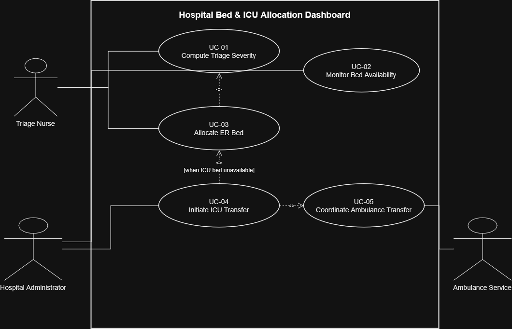

# Software Engineering Lab 1: Requirements Engineering & UML Use-Case Modelling

**Problem Statement #20 | Healthcare & Telemedicine**  
**Course:** Software Engineering Lab 1 | Department of CSE, PES University  
**Student:** Shriya K  
**SRN:** PES1UG24CS448  

---

## Overview

Lab 1 focuses on eliciting and documenting verifiable software requirements, formulating measurable acceptance criteria, constructing a UML Use-Case Diagram with proper associations and stereotypes (`<<include>>` and `<<extend>>`), and detailing a formal 1-page Use-Case Flow Specification for a core use case.

---

## Deliverables Summary

| Deliverable | Required Format | File Location | Status |
|---|---|---|:---:|
| **Complete Requirements Table** | Markdown | [requirements/Requirements_Table.md](requirements/Requirements_Table.md) | Complete |
| **Complete Requirements Table** | Word Document | [requirements/Requirements_Table.docx](requirements/Requirements_Table.docx) | Complete |
| **Complete Requirements Table** | PDF Document | [requirements/Requirements_Table.pdf](requirements/Requirements_Table.pdf) | Complete |
| **Alternate Flows Specification** | Markdown | [requirements/Alternate_Flow.md](requirements/Alternate_Flow.md) | Complete |
| **Exception Flows Specification** | Markdown | [requirements/Exception_Flow.md](requirements/Exception_Flow.md) | Complete |
| **UML Use-Case Diagram** | PNG Image | [uml/Use_Case_Diagram.png](uml/Use_Case_Diagram.png) | Complete |
| **UML Use-Case Diagram** | PDF Document | [uml/Use_Case_Diagram.pdf](uml/Use_Case_Diagram.pdf) | Complete |
| **UML Use-Case Diagram Spec** | Markdown | [uml/Use_Case_Diagram.md](uml/Use_Case_Diagram.md) | Complete |
| **Use-Case Flow Specification** | Word Document | [use-case-flow/ICU_Transfer_Flow.docx](use-case-flow/ICU_Transfer_Flow.docx) | Complete |
| **Use-Case Flow Specification** | PDF Document | [use-case-flow/ICU_Transfer_Flow.pdf](use-case-flow/ICU_Transfer_Flow.pdf) | Complete |
| **Use-Case Flow Specification** | Markdown | [use-case-flow/ICU_Transfer_Flow.md](use-case-flow/ICU_Transfer_Flow.md) | Complete |
| **Problem Statement Reference** | PDF Document | [20_SE_Lab1_SE_Problem_Statements.pdf](20_SE_Lab1_SE_Problem_Statements.pdf) | Complete |

---

## Requirements Summary
- **Functional Requirements:** Exactly five FRs (**FR-001** to **FR-005**) specifying triage severity computation, real-time multi-ward bed status, automated ER bed allocation, ICU inter-facility transfer requests, and ambulance dispatch coordination.
- **Non-Functional Requirements:** Two NFRs (**NFR-001** for sub-second WebSocket latency and **NFR-002** for role-based access control security).

## Use-Case Diagram Preview

- **Actors:** Triage Nurse (Primary), Hospital Administrator (Primary), Ambulance Service (External System).
- **`<<include>>` Relationships:** 
  - `UC-03 (Allocate ER Bed) -- <<include>> --> UC-01 (Compute Triage Severity)`
  - `UC-04 (Initiate ICU Transfer) -- <<include>> --> UC-05 (Coordinate Ambulance Transfer)`
- **`<<extend>>` Relationship:** 
  - `UC-04 (Initiate ICU Transfer) -- <<extend>> --> UC-03 (Allocate ER Bed)` with condition `[when ICU bed unavailable]`.
