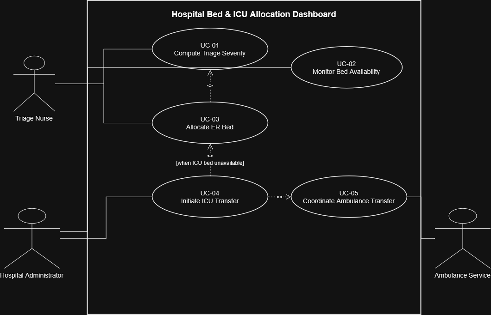
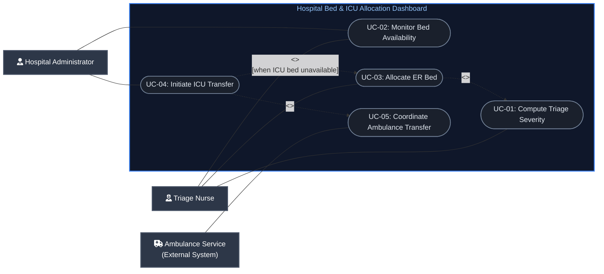

# UML Use-Case Diagram

## Hospital Bed & ICU Allocation Dashboard
**Problem Statement #20 | Healthcare & Telemedicine**  
**Course:** Software Engineering Lab 1 (Requirements Engineering & UML Use-Case Modelling)  
**Department of Computer Science & Engineering, PES University**

---

## 1. Visual Diagram

---

## 2. Mermaid Representation

---

## 3. System Boundary & Actors

### System Boundary
**Hospital Bed & ICU Allocation Dashboard**: A real-time web-based clinical management system operating in emergency departments to prioritize intake waitlists, monitor multi-ward bed occupancy, automate allocation, and coordinate inter-facility ICU patient transfers.

### Actors Specification

| Actor | Type | Description | Responsibilities |
|---|---|---|---|
| **Triage Nurse** | Primary Actor (Human) | Clinical frontline nursing staff in the emergency department intake area. | Records patient intake vitals, triggers triage calculation, monitors ER waitlist order, and allocates available ER beds to waiting patients. |
| **Hospital Administrator** | Primary Actor (Human) | Administrative and supervisory staff responsible for bed management and inter-hospital logistics. | Oversees ward and ICU bed utilization, authorizes inter-facility ICU transfer requests when hospital capacity is breached, and manages hospital resource allocations. |
| **Ambulance Service** | Secondary / External System Actor | External emergency dispatch service / inter-facility medical transport provider. | Receives automated ambulance dispatch requests, returns status confirmations (Confirmed / Rejected), provides transit telemetry, and reports transfer completion. |

---

## 4. Use Case Specifications

### UC-01: Compute Triage Severity
- **Use Case ID:** UC-01
- **Name:** Compute Triage Severity
- **Primary Actor:** Triage Nurse
- **Traceable Requirement:** FR-001
- **Description:** The system ingests patient intake vitals (blood pressure, heart rate, SpO2, respiratory rate, body temperature, pain scale, and consciousness level) and computes an objective triage severity acuity score (e.g., ESI level 1-5). It dynamically sorts the ER bed allocation waiting list, placing critical patients ahead of lower-acuity patients.

### UC-02: Monitor Bed Availability
- **Use Case ID:** UC-02
- **Name:** Monitor Bed Availability
- **Primary Actors:** Triage Nurse, Hospital Administrator
- **Traceable Requirements:** FR-002, NFR-001
- **Description:** The system displays real-time bed inventory across ER, general ward, and ICU wards categorized by status (`Available`, `Occupied`, `Cleaning`). Status transitions are propagated to all connected dashboard clients via WebSockets in under 1 second.

### UC-03: Allocate ER Bed
- **Use Case ID:** UC-03
- **Name:** Allocate ER Bed
- **Primary Actor:** Triage Nurse
- **Traceable Requirement:** FR-003
- **Description:** When an ER bed transitions to `Available`, the system matches the bed with the highest-priority eligible patient from the dynamic waitlist. The nurse confirms the assignment, updating the bed status to `Occupied` and removing the patient from the active queue.

### UC-04: Initiate ICU Transfer
- **Use Case ID:** UC-04
- **Name:** Initiate ICU Transfer
- **Primary Actor:** Hospital Administrator
- **Traceable Requirement:** FR-004
- **Description:** When a critical patient requires intensive care and all internal ICU beds are fully occupied or unavailable, this use case generates an inter-facility ICU transfer request to an external partner hospital with matching capacity.

### UC-05: Coordinate Ambulance Transfer
- **Use Case ID:** UC-05
- **Name:** Coordinate Ambulance Transfer
- **Primary Actor:** Ambulance Service (External System)
- **Traceable Requirement:** FR-005
- **Description:** The system dispatches inter-facility transfer requests to the external ambulance service with patient acuity details, tracks provider response status (`Requested`, `Confirmed`, `Rejected`), and logs real-time dispatch progress.

---

## 5. Use Case Relationships & Stereotypes

### 1. `<<include>>` Relationships
1. **`UC-03 (Allocate ER Bed) -- <<include>> --> UC-01 (Compute Triage Severity)`**
   - **Rationale:** The ER bed allocation process cannot determine the highest-priority patient without computing and retrieving the dynamic triage severity score. Hence, `UC-03` unconditionally includes `UC-01` to ensure clinical acuity drives bed distribution.
2. **`UC-04 (Initiate ICU Transfer) -- <<include>> --> UC-05 (Coordinate Ambulance Transfer)`**
   - **Rationale:** Initiating an inter-facility ICU transfer mandates dispatching transport to move the critically ill patient to the receiving hospital. Therefore, executing `UC-04` unconditionally invokes `UC-05` to engage the external Ambulance Service.

### 2. `<<extend>>` Relationships
1. **`UC-04 (Initiate ICU Transfer) -- <<extend>> --> UC-03 (Allocate ER Bed)`**
   - **Extension Point:** `ER Bed Allocation / Capacity Assessment`
   - **Condition:** `[when ICU bed unavailable]`
   - **Rationale:** During bed allocation or clinical reassessment in the ER, if a patient's condition escalates to requiring intensive care but internal ICU bed availability is zero, the workflow is extended to initiate an external inter-facility ICU transfer. If internal ICU beds are available, this extension is not triggered.

---

## 6. Requirements Traceability Matrix

| Requirement ID | Requirement Type | Priority | Mapped Use Case | Primary Actor(s) |
|---|---|---|---|---|
| **FR-001** | Functional | High | UC-01: Compute Triage Severity | Triage Nurse |
| **FR-002** | Functional | High | UC-02: Monitor Bed Availability | Triage Nurse, Hospital Administrator |
| **FR-003** | Functional | High | UC-03: Allocate ER Bed | Triage Nurse |
| **FR-004** | Functional | High | UC-04: Initiate ICU Transfer | Hospital Administrator |
| **FR-005** | Functional | Medium | UC-05: Coordinate Ambulance Transfer | Ambulance Service |
| **NFR-001** | Non-Functional (Performance & Security) | High | UC-02: Monitor Bed Availability | Triage Nurse, Hospital Administrator |
| **NFR-002** | Non-Functional (Security - RBAC) | High | UC-01 through UC-05 | All Actors |
