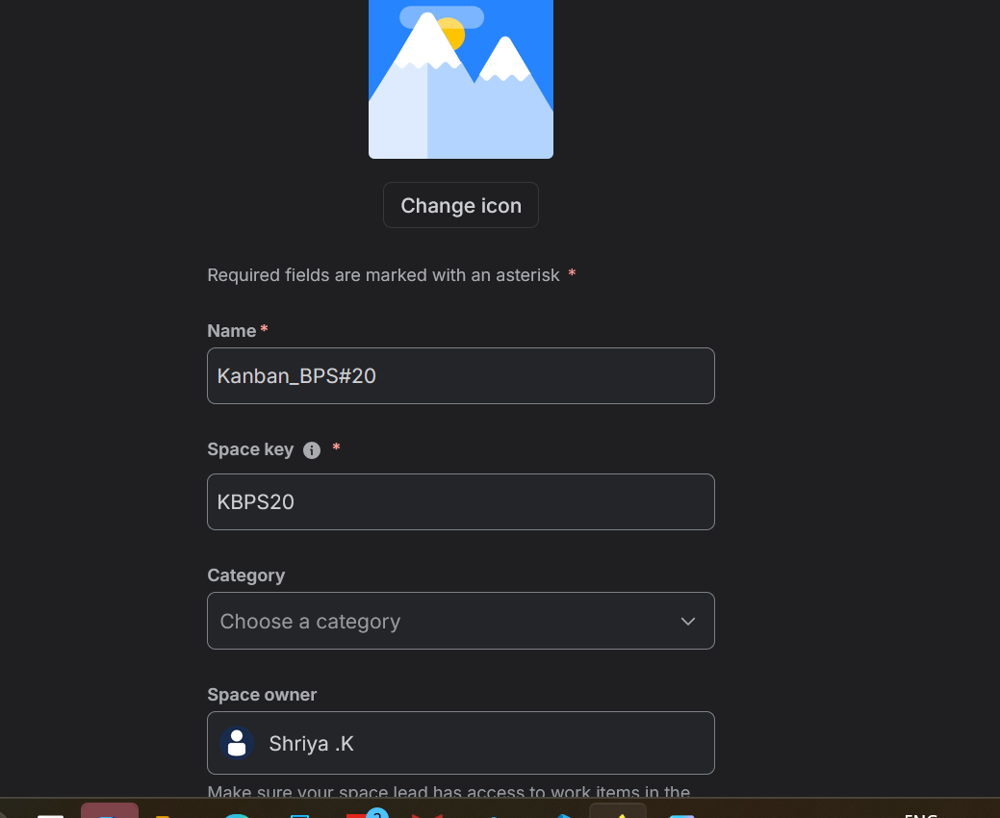
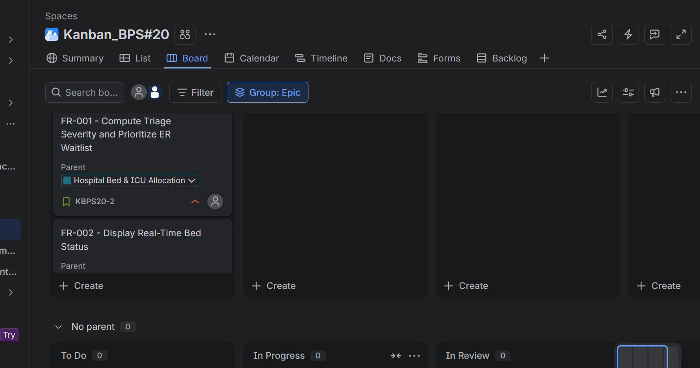
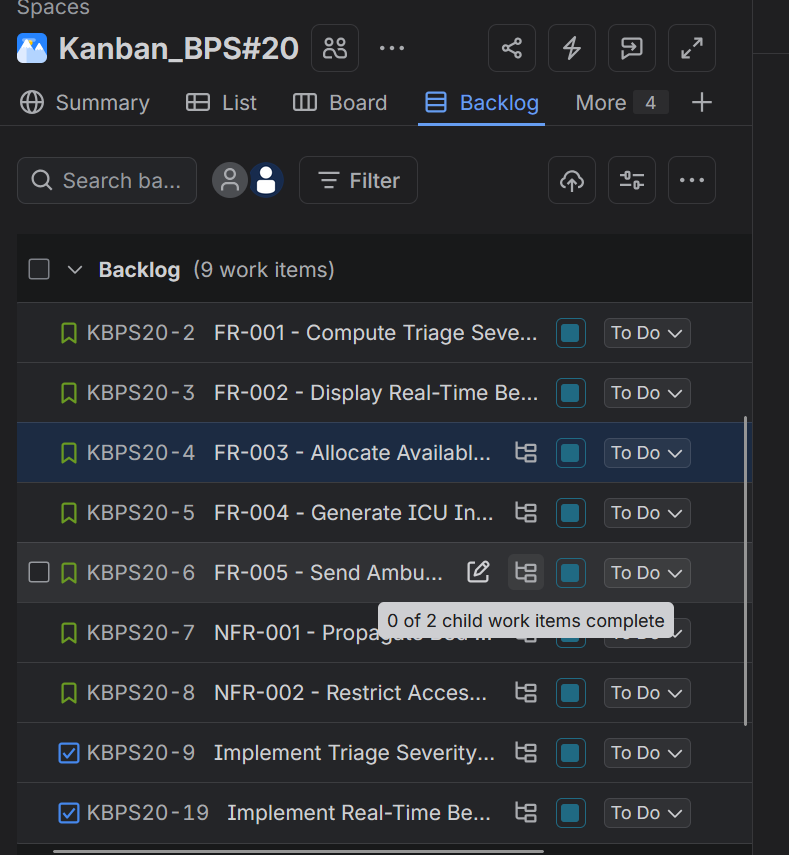
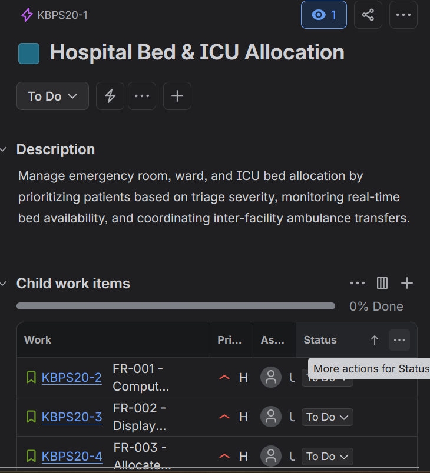
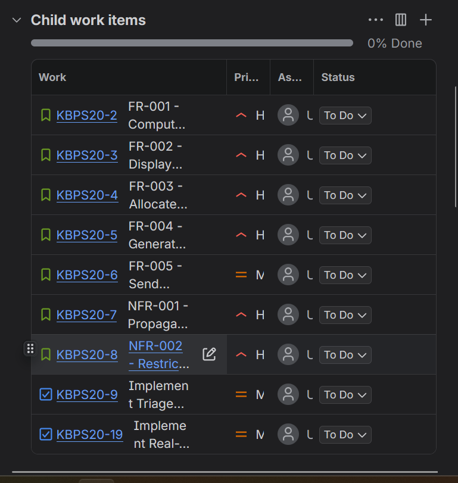
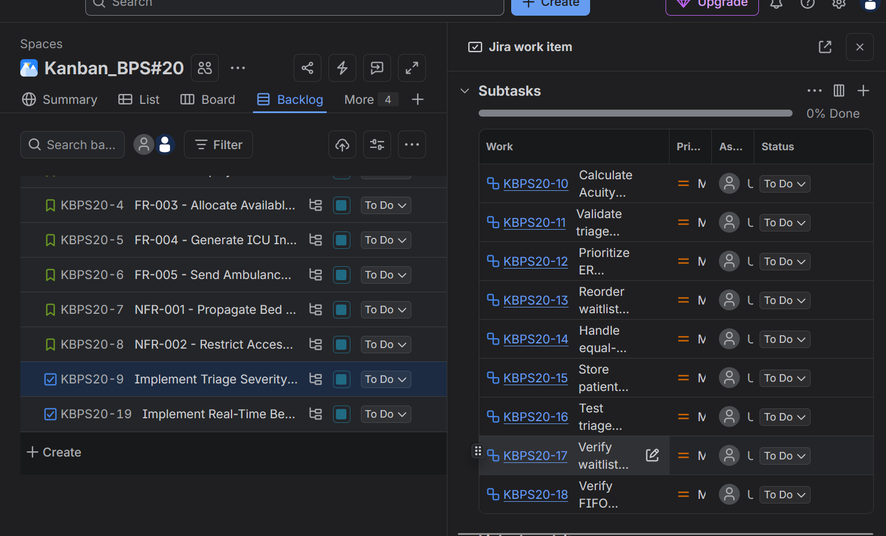
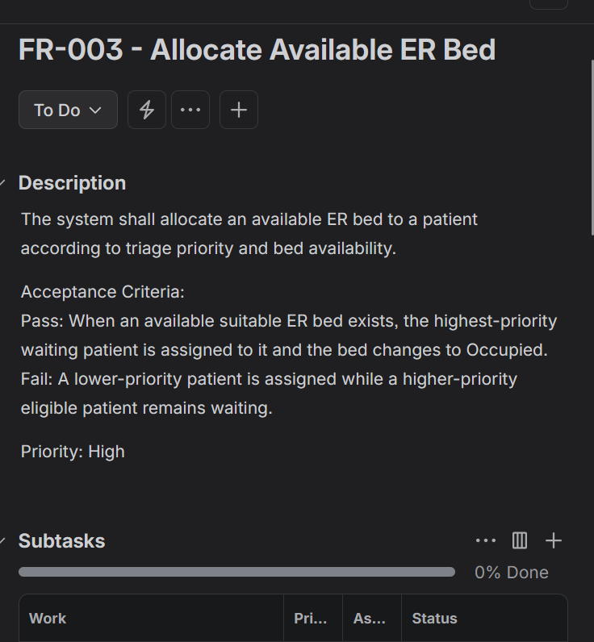
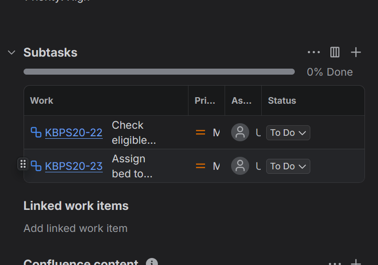

# Software Engineering Lab 2: Agile Project Management using Jira Kanban

**Course:** Software Engineering Lab | Department of CSE, PES University  
**Student Name:** Shriya K  
**SRN:** PES1UG24CS448  
**Section:** 5H  
**Project Name:** `Kanban_BPS#20`  
**Space Key:** `KBPS20`  
**Space Owner:** `Shriya .K`  
**Problem Statement:** #20 (Hospital Bed & ICU Allocation Dashboard)

---

## 1. Overview

Lab 2 focuses on applying agile project management principles using **Jira Software (Kanban framework)**. The activity encompasses:
- Configuring a dedicated Kanban project for the assigned healthcare system (**Problem Statement #20**).
- Establishing an overarching **Epic** to represent the full product capability.
- Formulating **User Stories / Functional Requirements (FRs)** and **Non-Functional Requirements (NFRs)** with clear descriptions and measurable acceptance criteria.
- Decomposing stories into actionable technical **Tasks** and granular **Subtasks**.
- Setting up the **Kanban Board** with agile workflow stages (`To Do`, `In Progress`, `In Review`, `Done`) grouped by Epic.

---

## 2. Deliverables Summary

| Deliverable | Format | File Location | Status |
|---|---|---|:---:|
| **Word Document Documentation** | Word Document | [LAB2_Kanban_Project_Documentation.docx](LAB2_Kanban_Project_Documentation.docx) | Complete |
| **PDF Document Documentation** | PDF Document | [LAB2_Kanban_Project_Documentation.pdf](LAB2_Kanban_Project_Documentation.pdf) | Complete |
| **Work Breakdown Structure (WBS)** | Markdown | [Kanban_Work_Breakdown_Structure.md](Kanban_Work_Breakdown_Structure.md) | Complete |
| **Extracted Screenshots Directory** | PNG Images | [screenshots/](screenshots/) | Complete (8 Images) |

---

## 3. Project Configuration & Screenshots Walkthrough

### 1. Project Creation
- **Project Name:** `Kanban_BPS#20`
- **Space Key:** `KBPS20`
- **Space Owner:** `Shriya .K`

---

### 2. Kanban Board (Grouped by Epic)
- Board shows active work grouped by parent epic **Hospital Bed & ICU Allocation**, showing child items such as `KBPS20-2` (FR-001) and `KBPS20-3` (FR-002) organized across agile delivery columns: `To Do`, `In Progress`, `In Review`, and `Done`.

---

### 3. Product Backlog
- Backlog containing 9 prioritized work items including all Functional Requirements (**FR-001 to FR-005**), Non-Functional Requirements (**NFR-001 & NFR-002**), and core technical implementation tasks (**KBPS20-9** and **KBPS20-19**).

---

### 4. Epic Definition & Scope (`KBPS20-1`)
- **Key:** `KBPS20-1`
- **Title:** `Hospital Bed & ICU Allocation`
- **Description:** *"Manage emergency room, ward, and ICU bed allocation by prioritizing patients based on triage severity, monitoring real-time bed availability, and coordinating inter-facility ambulance transfers."*

---

### 5. Technical Task & Subtasks Decomposition (`KBPS20-9`)
- Core engineering task **KBPS20-9: Implement Triage Severity Algorithm and Priority Engine** decomposed into 9 granular subtasks:
  - `KBPS20-10`: Calculate Acuity Score from Physiological Intake Vitals
  - `KBPS20-11`: Validate Triage Input Fields & Bounds Check
  - `KBPS20-12`: Prioritize ER Bed Allocation Waitlist by Score
  - `KBPS20-13`: Reorder Waitlist Dynamically on Patient Arrival / Re-Triage
  - `KBPS20-14`: Handle Equal-Acuity Tie-Breaker via Arrival Timestamp
  - `KBPS20-15`: Store Patient Triage Records in Patient Database
  - `KBPS20-16`: Test Triage Scoring Algorithm with Clinical Vitals Edge Cases
  - `KBPS20-17`: Verify Waitlist Preemption for High-Acuity Emergencies
  - `KBPS20-18`: Verify FIFO Queue Fallback within Same Acuity Tier

---

### 6. Functional Requirement Acceptance Criteria & Subtasks (`KBPS20-4`)
- **Item:** `KBPS20-4: FR-003 - Allocate Available ER Bed`
- **Description:** *"The system shall allocate an available ER bed to a patient according to triage priority and bed availability."*
- **Acceptance Criteria:**
  - *Pass:* When an available suitable ER bed exists, the highest-priority waiting patient is assigned to it and the bed changes to Occupied.
  - *Fail:* A lower-priority patient is assigned while a higher-priority eligible patient remains waiting.
- **Engineering Subtasks:**
  - `KBPS20-22`: Check Eligible Available ER Bed Matching Patient Requirements
  - `KBPS20-23`: Assign Bed to Patient and Transition Bed Status to Occupied

