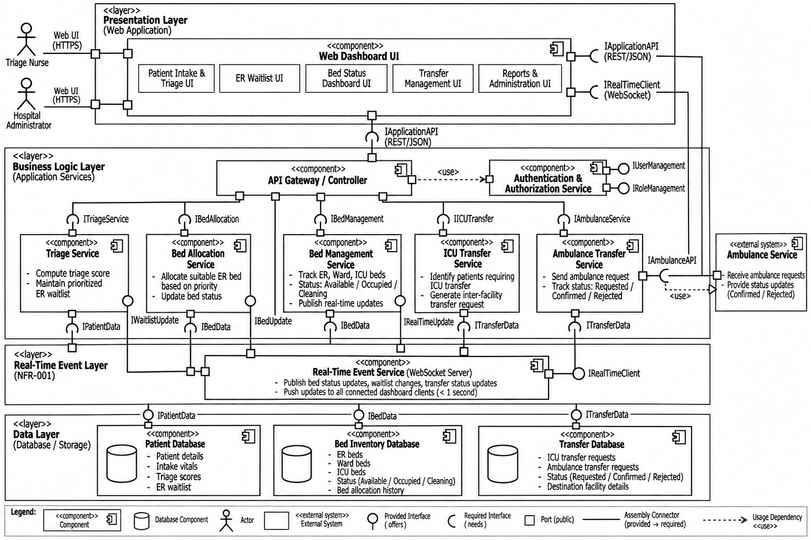

# UML Component Modeling Specification

## Hospital Bed & ICU Allocation Dashboard
**Problem Statement #20 | Healthcare & Telemedicine**  
**Course:** Software Engineering Lab 3 (Component Modelling & Architectural Pattern Selection)  
**Student:** Shriya K (PES1UG24CS448) | Department of CSE, PES University

---

## 1. Visual Component Diagram

*PDF version available at [Component_Diagram.pdf](Component_Diagram.pdf).*

---

## 2. Component Catalog & Stereotypes

The architecture includes 11 components organized across 4 vertical tiers and an external system boundary:

| Layer | Component Name | Stereotype | Responsibilities |
|---|---|---|---|
| **Presentation Layer** | **Web Dashboard UI** | `<<component>>` | Renders user views: Patient Intake & Triage, ER Waitlist, Bed Status Dashboard, Transfer Management, and Reports & Administration. Connects via public ports. |
| **Business Logic Layer** | **API Gateway / Controller** | `<<component>>` | Unified entry point for client HTTP REST requests. Routes requests to domain services. |
| **Business Logic Layer** | **Authentication & Authorization Service** | `<<component>>` | Verifies user credentials, issues JWT tokens, and evaluates Role-Based Access Control (RBAC) permissions (NFR-002). |
| **Business Logic Layer** | **Triage Service** | `<<component>>` | Ingests vitals, executes triage calculation algorithm (ESI levels 1-5), and maintains dynamically prioritized ER waitlist queue (FR-001). |
| **Business Logic Layer** | **Bed Allocation Service** | `<<component>>` | Evaluates bed eligibility, matches waiting patients to available beds by acuity, and executes allocation transitions (FR-003). |
| **Business Logic Layer** | **Bed Management Service** | `<<component>>` | Tracks status of ER, Ward, and ICU beds (`Available`, `Occupied`, `Cleaning`), triggers sanitation workflows, and emits real-time updates (FR-002). |
| **Business Logic Layer** | **ICU Transfer Service** | `<<component>>` | Identifies patients requiring intensive care, verifies internal ICU capacity, queries regional partner facilities, and creates inter-facility transfer requests (FR-004). |
| **Business Logic Layer** | **Ambulance Transfer Service** | `<<component>>` | Interfaces with external ambulance dispatch providers, transmits transport requests, and tracks response status (FR-005). |
| **Real-Time Event Layer** | **Real-Time Event Service (WebSocket Server)** | `<<component>>` | Maintains persistent client socket connections and broadcasts status deltas for beds, waitlists, and transfers in &lt; 1 second (NFR-001). |
| **Data Layer** | **Patient Database** | `<<component>>` | Relational store for patient demographics, intake vitals, computed triage scores, and active ER waitlists. |
| **Data Layer** | **Bed Inventory Database** | `<<component>>` | Relational store for multi-ward bed inventory, current states, and allocation logs. |
| **Data Layer** | **Transfer Database** | `<<component>>` | Relational store for inter-facility ICU transfer requests, partner hospital details, and ambulance dispatch statuses. |
| **External Systems** | **Ambulance Service** | `<<external system>>` | Third-party emergency vehicle dispatch and transit telemetry provider. |

---

## 3. Interface Specifications (Ball and Socket Notation)

The architecture specifies formal provided interfaces (ball notation: circle) and required interfaces (socket notation: semicircle):

| Interface Name | Provider Component (Ball) | Consumer Component (Socket) | Protocol / Technology | Description |
|---|---|---|---|---|
| **`IApplicationAPI`** | API Gateway / Controller | Web Dashboard UI | HTTPS REST / JSON | Exposes all patient intake, bed management, and transfer management endpoints. |
| **`IRealTimeClient`** | Real-Time Event Service | Web Dashboard UI | WSS (WebSocket) | Full-duplex persistent stream pushing bed transitions and waitlist updates. |
| **`IUserManagement`** | Authentication & Auth Service | API Gateway / Controller | In-Process / RPC | User credential validation and account management. |
| **`IRoleManagement`** | Authentication & Auth Service | API Gateway / Controller | In-Process / RPC | Role-based permission evaluation (Triage Nurse vs. Administrator). |
| **`ITriageService`** | Triage Service | API Gateway / Controller | In-Process / REST | Submits patient vitals and returns computed triage priority ranking. |
| **`IBedAllocation`** | Bed Allocation Service | API Gateway / Controller | In-Process / REST | Executes bed assignment workflow for highest-urgency waiting patient. |
| **`IBedManagement`** | Bed Management Service | API Gateway / Controller | In-Process / REST | Queries multi-ward bed occupancy and triggers sanitation status updates. |
| **`IICUTransfer`** | ICU Transfer Service | API Gateway / Controller | In-Process / REST | Initiates and manages inter-facility ICU transfer requests. |
| **`IAmbulanceService`** | Ambulance Transfer Service | API Gateway / Controller | In-Process / REST | Dispatches transport requests and queries vehicle transit statuses. |
| **`IAmbulanceAPI`** | External Ambulance System | Ambulance Transfer Service | HTTPS REST / JSON | External dispatch endpoint receiving patient acuity, pickup location, and ETA. |
| **`IPatientData`** | Patient Database | Triage Service, Bed Allocation | SQL / JDBC | CRUD operations on patient intake records, vitals, and waitlist tables. |
| **`IBedData`** | Bed Inventory Database | Bed Allocation, Bed Management | SQL / JDBC | CRUD operations on bed states (`Available`, `Occupied`, `Cleaning`). |
| **`ITransferData`** | Transfer Database | ICU Transfer, Ambulance Service | SQL / JDBC | CRUD operations on transfer records, partner hospital entries, and dispatch logs. |
| **`IWaitlistUpdate`** | Real-Time Event Service | Triage Service | Internal Event Bus | Publishes dynamic waitlist re-ordering events. |
| **`IBedUpdate`** | Real-Time Event Service | Bed Management Service | Internal Event Bus | Publishes bed status transitions for immediate client broadcast. |
| **`ITransferUpdate`** | Real-Time Event Service | ICU Transfer Service | Internal Event Bus | Publishes transfer confirmation and transit telemetry updates. |

---

## 4. Ports & Connectors

- **Public Ports:** Placed on component boundaries (e.g., Web Dashboard UI boundary, API Gateway boundary, and External Ambulance System boundary) to cleanly group provided and required interfaces.
- **Assembly Connectors:** Connect provided interface balls to matching required interface sockets across layers (e.g., `Web Dashboard UI` required socket connects to `API Gateway` provided ball via `IApplicationAPI`).
- **Usage Dependencies (`<<use>>`):** Represented as dashed arrows indicating that one component requires the services of another (e.g., `API Gateway` `--<<use>>-->` `Authentication & Authorization Service`).

---

## 5. Traceability to Requirements

- **FR-001 (Compute Triage Severity):** Realized by `Triage Service` using `IPatientData` and publishing via `IWaitlistUpdate`.
- **FR-002 (Real-Time Bed Monitoring):** Realized by `Bed Management Service` using `IBedData` and broadcasting via `Real-Time Event Service` (`IRealTimeClient`).
- **FR-003 (Allocate ER Bed):** Realized by `Bed Allocation Service` coordinating with `Bed Management Service` and `Patient Database`.
- **FR-004 (ICU Transfer Generation):** Realized by `ICU Transfer Service` recording to `Transfer Database` and invoking `Ambulance Transfer Service`.
- **FR-005 (Ambulance Dispatch):** Realized by `Ambulance Transfer Service` interfacing via `IAmbulanceAPI`.
- **NFR-001 (Sub-Second Latency):** Implemented via `Real-Time Event Service` WebSocket push architecture.
- **NFR-002 (RBAC Security):** Enforced centrally by `API Gateway` and `Authentication & Authorization Service`.
