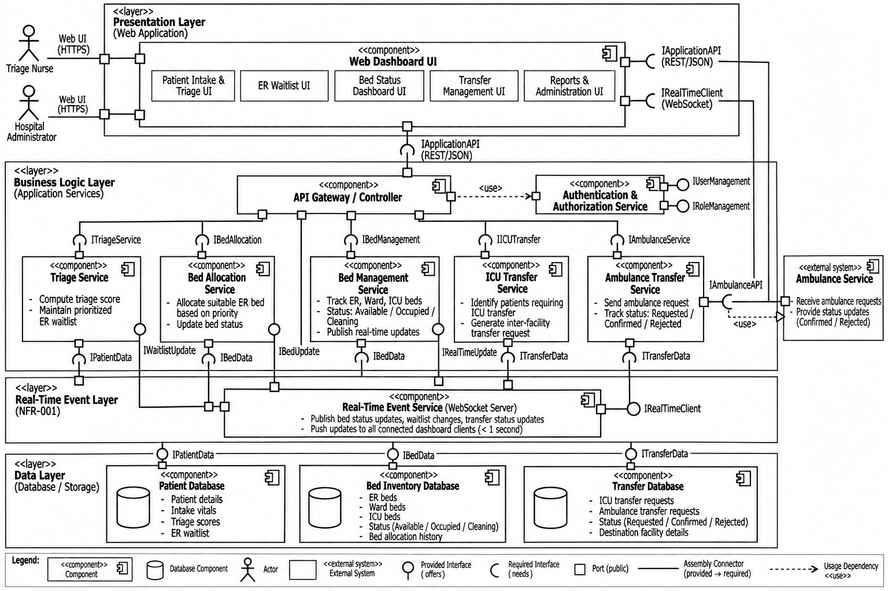

# Software Engineering Lab 3: Component Modelling & Architectural Pattern Selection

**Problem Statement #20 | Healthcare & Telemedicine**  
**Course:** Software Engineering Lab 3 | Department of CSE, PES University  
**Student:** Shriya K  
**SRN:** PES1UG24CS448  

---

## Overview

Lab 3 focuses on evaluating software architectural styles, selecting the most appropriate pattern for the assigned scenario (**Hospital Emergency Department Triage, Bed and Transfer Management System**), designing a comprehensive UML Component Diagram showing modules, ports, interfaces, and dependencies, and documenting the architectural decisions.

---

## Deliverables Summary

| Deliverable | Required Format | File Location | Status |
|---|---|---|:---:|
| **UML Component Diagram** | PNG Image | [Component_Diagram.png](Component_Diagram.png) | Complete |
| **UML Component Diagram** | PDF Document | [Component_Diagram.pdf](Component_Diagram.pdf) | Complete |
| **Written Justification Document** | Word Document | [Architecture_Selection_Justification.docx](Architecture_Selection_Justification.docx) | Complete |
| **Written Justification Document** | PDF Document | [Architecture_Selection_Justification.pdf](Architecture_Selection_Justification.pdf) | Complete |
| **Written Justification Document** | Markdown | [Architecture_Selection_Justification.md](Architecture_Selection_Justification.md) | Complete |
| **Architectural Styles Analysis** | Markdown | [Architectural_Styles_Analysis.md](Architectural_Styles_Analysis.md) | Complete |
| **Component Modeling Specification** | Markdown | [Component_Modeling_Specification.md](Component_Modeling_Specification.md) | Complete |

---

## Component Diagram Preview

### Key Architectural Highlights
1. **Layered Architecture:** 4 distinct horizontal tiers (Presentation, Business Logic, Real-Time Event, and Data).
2. **Components Modeled (&gt; 5 components):** 11 components with `<<component>>` stereotypes and icons.
3. **Interfaces Modeled (&gt; 4 interfaces):** 16 ball (provided) and socket (required) interfaces including `IApplicationAPI`, `IRealTimeClient`, `ITriageService`, `IBedAllocation`, `IBedManagement`, `IICUTransfer`, `IAmbulanceAPI`, and database persistence interfaces.
4. **Ports & Connectors:** Public ports on component boundaries, usage dependencies (`<<use>>`), and assembly connectors.
5. **Quality Attributes:** Sub-second WebSocket push event propagation (**NFR-001**) and centralized RBAC security perimeter (**NFR-002**).
